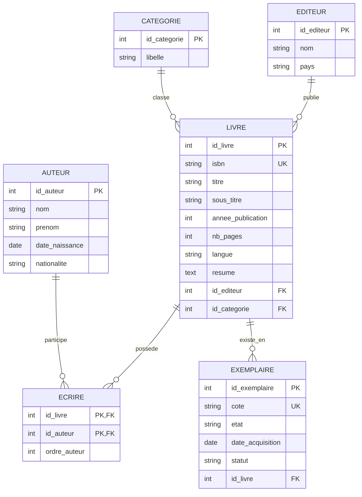

# modele-livre

Modèle relationnel de l'entité **Livre** pour une application de gestion de bibliothèque.

Notation : la clé primaire est <u>soulignée</u> (ici en **gras**), la clé étrangère est précédée de `#`.

---

## 1. Schéma relationnel

**EDITEUR** (**id_editeur**, nom, pays)

**CATEGORIE** (**id_categorie**, libelle)

**AUTEUR** (**id_auteur**, nom, prenom, date_naissance, nationalite)

**LIVRE** (**id_livre**, isbn, titre, sous_titre, annee_publication, nb_pages, langue, resume, #id_editeur, #id_categorie)

**ECRIRE** (**#id_livre**, **#id_auteur**, ordre_auteur)

**EXEMPLAIRE** (**id_exemplaire**, cote, etat, date_acquisition, statut, #id_livre)

---

## 2. Dictionnaire des données

### LIVRE

| Attribut | Type | Contrainte | Description |
|---|---|---|---|
| id_livre | INT | PK, auto-incrément | Identifiant interne du livre |
| isbn | VARCHAR(17) | UNIQUE, NOT NULL | Numéro ISBN (ISBN-13) |
| titre | VARCHAR(255) | NOT NULL | Titre principal |
| sous_titre | VARCHAR(255) | NULL | Sous-titre éventuel |
| annee_publication | SMALLINT | NULL | Année de publication |
| nb_pages | SMALLINT | CHECK (nb_pages > 0) | Nombre de pages |
| langue | VARCHAR(30) | NOT NULL | Langue de l'ouvrage |
| resume | TEXT | NULL | Résumé |
| id_editeur | INT | FK → EDITEUR | Éditeur du livre |
| id_categorie | INT | FK → CATEGORIE | Catégorie principale |

### EXEMPLAIRE

| Attribut | Type | Contrainte | Description |
|---|---|---|---|
| id_exemplaire | INT | PK, auto-incrément | Identifiant de l'exemplaire physique |
| cote | VARCHAR(30) | UNIQUE, NOT NULL | Cote de rangement en rayon |
| etat | VARCHAR(20) | NOT NULL | Neuf, bon, usé, abîmé |
| date_acquisition | DATE | NULL | Date d'entrée dans le fonds |
| statut | VARCHAR(20) | NOT NULL | Disponible, emprunté, réservé, retiré |
| id_livre | INT | FK → LIVRE, NOT NULL | Livre dont il est un exemplaire |

### ECRIRE (association Livre ↔ Auteur)

| Attribut | Type | Contrainte | Description |
|---|---|---|---|
| id_livre | INT | PK, FK → LIVRE | Livre concerné |
| id_auteur | INT | PK, FK → AUTEUR | Auteur concerné |
| ordre_auteur | TINYINT | NOT NULL | Rang de l'auteur (1 = auteur principal) |

---

## 3. Cardinalités

| Association | Cardinalité | Lecture |
|---|---|---|
| EDITEUR — LIVRE | 1,N — 1,1 | Un éditeur publie plusieurs livres ; un livre a un seul éditeur |
| CATEGORIE — LIVRE | 0,N — 1,1 | Une catégorie regroupe plusieurs livres ; un livre a une catégorie principale |
| LIVRE — AUTEUR | 1,N — 0,N | Un livre a un ou plusieurs auteurs ; un auteur écrit plusieurs livres |
| LIVRE — EXEMPLAIRE | 0,N — 1,1 | Un livre existe en plusieurs exemplaires ; un exemplaire correspond à un seul livre |

---

## 4. Diagramme entité-association



---

## 5. Script SQL

```sql
CREATE TABLE editeur (
    id_editeur  INT AUTO_INCREMENT PRIMARY KEY,
    nom         VARCHAR(100) NOT NULL,
    pays        VARCHAR(60)
);

CREATE TABLE categorie (
    id_categorie INT AUTO_INCREMENT PRIMARY KEY,
    libelle      VARCHAR(80) NOT NULL UNIQUE
);

CREATE TABLE auteur (
    id_auteur      INT AUTO_INCREMENT PRIMARY KEY,
    nom            VARCHAR(80) NOT NULL,
    prenom         VARCHAR(80),
    date_naissance DATE,
    nationalite    VARCHAR(60)
);

CREATE TABLE livre (
    id_livre          INT AUTO_INCREMENT PRIMARY KEY,
    isbn              VARCHAR(17)  NOT NULL UNIQUE,
    titre             VARCHAR(255) NOT NULL,
    sous_titre        VARCHAR(255),
    annee_publication SMALLINT,
    nb_pages          SMALLINT CHECK (nb_pages > 0),
    langue            VARCHAR(30)  NOT NULL,
    resume            TEXT,
    id_editeur        INT NOT NULL,
    id_categorie      INT NOT NULL,
    FOREIGN KEY (id_editeur)   REFERENCES editeur(id_editeur),
    FOREIGN KEY (id_categorie) REFERENCES categorie(id_categorie)
);

CREATE TABLE ecrire (
    id_livre     INT NOT NULL,
    id_auteur    INT NOT NULL,
    ordre_auteur TINYINT NOT NULL DEFAULT 1,
    PRIMARY KEY (id_livre, id_auteur),
    FOREIGN KEY (id_livre)  REFERENCES livre(id_livre)   ON DELETE CASCADE,
    FOREIGN KEY (id_auteur) REFERENCES auteur(id_auteur) ON DELETE CASCADE
);

CREATE TABLE exemplaire (
    id_exemplaire    INT AUTO_INCREMENT PRIMARY KEY,
    cote             VARCHAR(30) NOT NULL UNIQUE,
    etat             VARCHAR(20) NOT NULL,
    date_acquisition DATE,
    statut           VARCHAR(20) NOT NULL DEFAULT 'disponible',
    id_livre         INT NOT NULL,
    FOREIGN KEY (id_livre) REFERENCES livre(id_livre)
);
```
