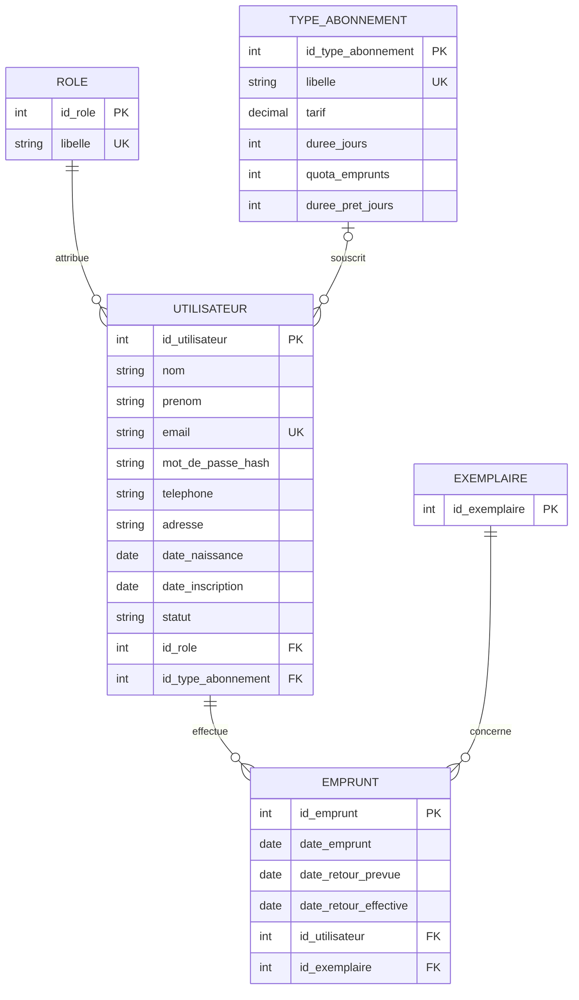

# modele-user

Modèle relationnel de l'entité **Utilisateur** pour une application de gestion de bibliothèque (adhérents, bibliothécaires, administrateurs). Il se raccorde à la table `EXEMPLAIRE` définie dans `modele-livre`.

Notation : la clé primaire est en **gras**, la clé étrangère est précédée de `#`.

---

## 1. Schéma relationnel

**ROLE** (**id_role**, libelle)

**TYPE_ABONNEMENT** (**id_type_abonnement**, libelle, tarif, duree_jours, quota_emprunts, duree_pret_jours)

**UTILISATEUR** (**id_utilisateur**, nom, prenom, email, mot_de_passe_hash, telephone, adresse, date_naissance, date_inscription, statut, #id_role, #id_type_abonnement)

**EMPRUNT** (**id_emprunt**, date_emprunt, date_retour_prevue, date_retour_effective, #id_utilisateur, #id_exemplaire)

---

## 2. Dictionnaire des données

### UTILISATEUR

| Attribut | Type | Contrainte | Description |
|---|---|---|---|
| id_utilisateur | INT | PK, auto-incrément | Identifiant interne |
| nom | VARCHAR(80) | NOT NULL | Nom de famille |
| prenom | VARCHAR(80) | NOT NULL | Prénom |
| email | VARCHAR(150) | UNIQUE, NOT NULL | Adresse e-mail, utilisée pour la connexion |
| mot_de_passe_hash | VARCHAR(255) | NOT NULL | Mot de passe haché (jamais en clair) |
| telephone | VARCHAR(20) | NULL | Numéro de téléphone |
| adresse | VARCHAR(255) | NULL | Adresse postale |
| date_naissance | DATE | NULL | Date de naissance |
| date_inscription | DATE | NOT NULL | Date d'inscription à la bibliothèque |
| statut | VARCHAR(20) | NOT NULL | Actif, suspendu, expiré |
| id_role | INT | FK → ROLE, NOT NULL | Rôle dans l'application |
| id_type_abonnement | INT | FK → TYPE_ABONNEMENT, NULL | Abonnement (vide pour le personnel) |

### ROLE

| Attribut | Type | Contrainte | Description |
|---|---|---|---|
| id_role | INT | PK, auto-incrément | Identifiant du rôle |
| libelle | VARCHAR(40) | UNIQUE, NOT NULL | Adhérent, bibliothécaire, administrateur |

### TYPE_ABONNEMENT

| Attribut | Type | Contrainte | Description |
|---|---|---|---|
| id_type_abonnement | INT | PK, auto-incrément | Identifiant du type d'abonnement |
| libelle | VARCHAR(60) | UNIQUE, NOT NULL | Étudiant, standard, famille… |
| tarif | DECIMAL(8,2) | CHECK (tarif >= 0) | Prix de l'abonnement |
| duree_jours | SMALLINT | NOT NULL | Durée de validité |
| quota_emprunts | TINYINT | NOT NULL | Nombre maximum de livres empruntés en même temps |
| duree_pret_jours | TINYINT | NOT NULL | Durée d'un prêt |

### EMPRUNT

| Attribut | Type | Contrainte | Description |
|---|---|---|---|
| id_emprunt | INT | PK, auto-incrément | Identifiant de l'emprunt |
| date_emprunt | DATE | NOT NULL | Date de sortie |
| date_retour_prevue | DATE | NOT NULL | Date limite de retour |
| date_retour_effective | DATE | NULL | Date réelle de retour (vide tant que non rendu) |
| id_utilisateur | INT | FK → UTILISATEUR, NOT NULL | Emprunteur |
| id_exemplaire | INT | FK → EXEMPLAIRE, NOT NULL | Exemplaire emprunté |

---

## 3. Cardinalités

| Association | Cardinalité | Lecture |
|---|---|---|
| ROLE — UTILISATEUR | 0,N — 1,1 | Un rôle est attribué à plusieurs utilisateurs ; un utilisateur a un seul rôle |
| TYPE_ABONNEMENT — UTILISATEUR | 0,N — 0,1 | Un type d'abonnement concerne plusieurs utilisateurs ; un utilisateur a au plus un abonnement |
| UTILISATEUR — EMPRUNT | 0,N — 1,1 | Un utilisateur effectue plusieurs emprunts ; un emprunt est fait par un seul utilisateur |
| EXEMPLAIRE — EMPRUNT | 0,N — 1,1 | Un exemplaire est emprunté plusieurs fois au fil du temps ; un emprunt porte sur un seul exemplaire |

---

## 4. Diagramme entité-association



---

## 5. Script SQL

```sql
CREATE TABLE role (
    id_role INT AUTO_INCREMENT PRIMARY KEY,
    libelle VARCHAR(40) NOT NULL UNIQUE
);

CREATE TABLE type_abonnement (
    id_type_abonnement INT AUTO_INCREMENT PRIMARY KEY,
    libelle            VARCHAR(60)  NOT NULL UNIQUE,
    tarif              DECIMAL(8,2) NOT NULL CHECK (tarif >= 0),
    duree_jours        SMALLINT     NOT NULL,
    quota_emprunts     TINYINT      NOT NULL,
    duree_pret_jours   TINYINT      NOT NULL
);

CREATE TABLE utilisateur (
    id_utilisateur     INT AUTO_INCREMENT PRIMARY KEY,
    nom                VARCHAR(80)  NOT NULL,
    prenom             VARCHAR(80)  NOT NULL,
    email              VARCHAR(150) NOT NULL UNIQUE,
    mot_de_passe_hash  VARCHAR(255) NOT NULL,
    telephone          VARCHAR(20),
    adresse            VARCHAR(255),
    date_naissance     DATE,
    date_inscription   DATE         NOT NULL,
    statut             VARCHAR(20)  NOT NULL DEFAULT 'actif',
    id_role            INT          NOT NULL,
    id_type_abonnement INT,
    FOREIGN KEY (id_role)            REFERENCES role(id_role),
    FOREIGN KEY (id_type_abonnement) REFERENCES type_abonnement(id_type_abonnement)
);

CREATE TABLE emprunt (
    id_emprunt            INT AUTO_INCREMENT PRIMARY KEY,
    date_emprunt          DATE NOT NULL,
    date_retour_prevue    DATE NOT NULL,
    date_retour_effective DATE,
    id_utilisateur        INT  NOT NULL,
    id_exemplaire         INT  NOT NULL,
    CHECK (date_retour_prevue >= date_emprunt),
    FOREIGN KEY (id_utilisateur) REFERENCES utilisateur(id_utilisateur),
    FOREIGN KEY (id_exemplaire)  REFERENCES exemplaire(id_exemplaire)
);
```
